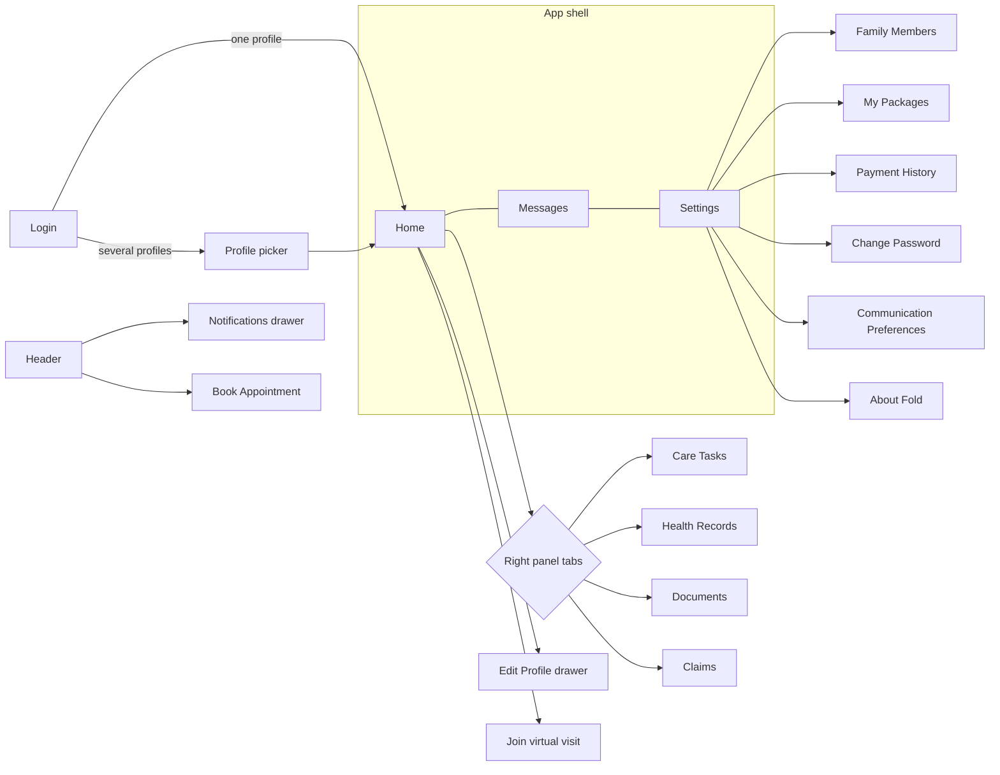
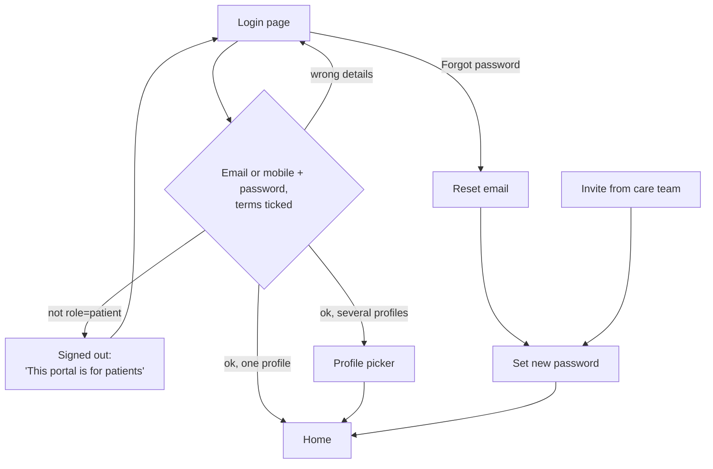
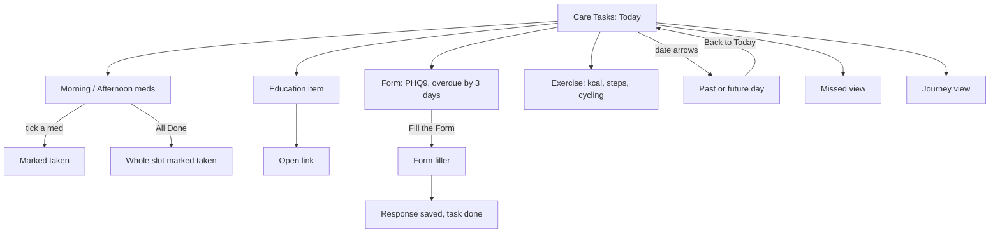
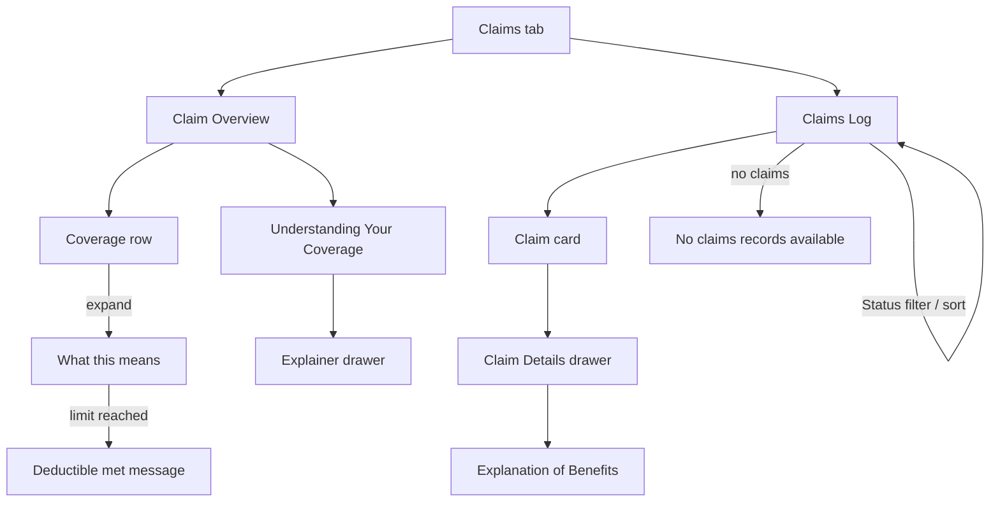
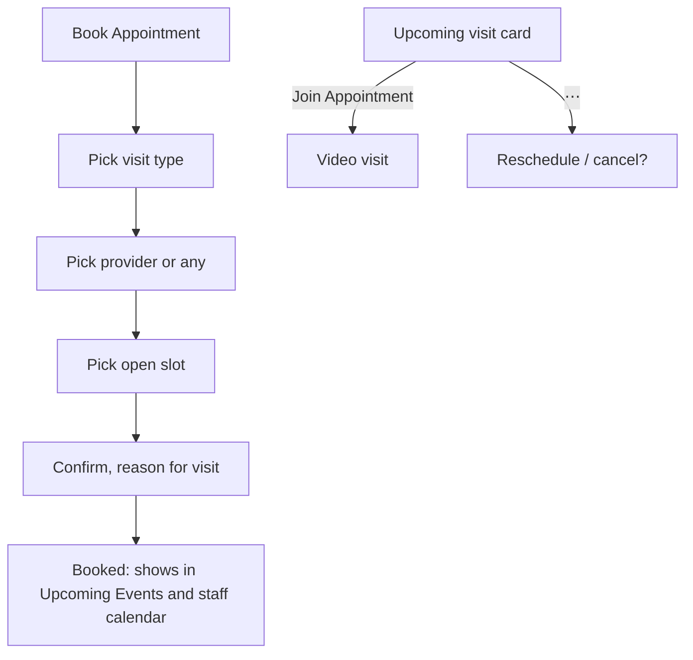

# Patient App Workflows

> **Why this doc exists.** The patient app (patients.foldhealth.org, code in
> `patient/`) is designed in the Figma file
> [Fold Patient Web App SST](https://www.figma.com/design/sTOVTZZbJeQPGDu7blDxNu/Fold-Patient-Web-App-SST?node-id=39-5771).
> This doc turns every frame on that page into the user workflows the app has
> to support, says which tables already hold the data, and lists what the
> designs leave open. Read it before building any patient screen. Companion:
> `supabase/staff_patient_rls_split_migration.sql` (the staff-only gate every
> patient table has to open deliberately).

---

## 1. Who uses it

| Actor | What they do |
|---|---|
| **Patient** | Signs in, follows their care plan, books and joins visits, messages the care team, reads records, documents and claims. |
| **Household manager** | One sign-in that manages several people. After login they pick a profile (`Nathan`, `Leo`) and can switch with the `Nathan ⌄` control on Home. Everything below runs in the context of the selected profile. |
| **Care team** (staff app) | The other side of every workflow: assigns tasks, education and forms, schedules visits, answers messages, shares documents. |

Identity rules:

- A patient account is an `auth.users` row with `app_metadata.role = 'patient'`, created server-side only. The app signs out anyone else.
- The account links to one or more patient records by **member_id** (the Fold ID; source tables key patients by it, see `patient_id` columns). That link table does not exist yet (`patient_accounts (user_id, member_id, relationship, is_primary)`); the profile picker reads it.
- **Family Member** on Home (`Smith Jones, Father`) is a *contact* (`patient_contacts`), not a second profile. Don't confuse it with household profiles.

---

## 2. Navigation map

Shell (every signed-in screen): `NavRail` with Home, Messages (unread badge), Settings, Help, Logout; header with page title, notifications bell (unread badge), **Book Appointment**, avatar.

Home is a three-column layout:

1. **Profile column**: profile switcher, name, sex and age, email, phone, Edit Profile; Care Team (PCP, Care Manager, Support Member, each with a message icon); Family Member; Membership.
2. **Upcoming Events**: next visit card (date, provider, visit type, time, **Join Appointment**, ⋯ menu); promo card ("Introducing Packages", Explore Package, dismissible).
3. **Tabbed panel**: Care Tasks, Health Records, Documents, Claims.

---

## 3. Screen inventory

| Frame | Screen | Workflow |
|---|---|---|
| `701:4799` | Login, empty | W1 |
| `701:4783` | Login, filled (terms ticked, Login enabled) | W1 |
| `701:4769` | Profile picker (`NJ Nathan`, `LJ Leo`) | W2 |
| `701:5587` | Intro card carousel (2 slides) | W1 |
| `701:4555` | Home, Care Tasks, today | W3, W5 |
| `701:4815` | Home, Care Tasks, past date (23 Nov 2023, Back to Today) | W5 |
| `701:5011` | Home, Health Records | W6 |
| `701:5182` | Home, Documents | W7 |
| `1114:6472` | Home, Claims, Claim Overview | W10 |
| `1114:7588` | Claim Overview with no spend ("No deductions yet") | W10 |
| `1114:6886` | Claims Log | W10 |
| `1114:6763` | Claims Log empty ("No claims records available") | W10 |
| `1114:7011` | Claim Details drawer | W10 |
| `1114:7077` | Explanation of Benefits, collapsed and expanded | W10 |
| `1114:7137` | Coverage row states: default, hover, expanded, deductible met, empty | W10 |
| `1114:7548`, `1114:7010` | Claim card default and hover; status badge | W10 |
| `1114:7063` | Understanding Your Coverage drawer | W10 |
| `1114:7583`, `1114:7584` | Claims status filter (All, Pending, Submitted, In Review, Paid, Rejected) | W10 |
| `1114:7585` | Claims sort (Recent First, Old First) | W10 |
| `1114:7586`, `1114:7587` | Designer note: clearinghouse codes INC, EXC, EXT, PAID, PAY, PENDED | W10 |
| `701:5360` | Messages | W8 |
| `701:5509` | Notifications drawer | W9 |
| `701:5539` | Edit Profile drawer | W4 |
| `701:5439` | Settings, My Packages | W11 |

---

## 4. Workflows

Each workflow lists the goal, the steps, the states the design shows, where the data lives today, and what is still open.

### W1. Sign in

**Goal:** get a patient into their portal; keep everyone else out.

1. Patient enters email or mobile (design says "User Name / Email / Mobile"; Supabase has no usernames, so the app accepts email or mobile) and password.
2. Login stays disabled until the terms checkbox is ticked.
3. On success with one linked profile, go to Home; with several, show the picker.
4. Left side: two-slide carousel ("Schedule remote visits or instant video visit", "Refill meds, manage care plan & get care on demand").
5. Below the card: "Stay connected with your healthcare experts on the go via our mobile apps" with App Store and Google Play badges.

**Built:** steps 1 to 4, reset (`patient/auth/`).
**Care team sign-in (built):** provider-portal users sign in with the same email and password, or Google (Microsoft shows "Coming soon", as in the staff app). Instead of the profile picker they get "View the portal as a patient": search any patient by name or member ID, with patients who use the portal listed first. A banner shows who they are viewing as, with Switch patient. Messages they send are labeled "<name> (staff, viewing as patient)" for staff, and visits they book carry "Booked by <name> in the patient portal" in the staff instructions; patients see neither label. A Google sign-up awaiting admin approval gets the approval notice. See `supabase/staff_patient_portal_access_migration.sql` and `patient/profiles/StaffViewAsGate.jsx`.
**Invites (built):** staff give access from the patient's Profile tab (Patient Portal section). `/api/patient-invite` creates the account with `role: patient` (or reuses an existing patient account), links it in `patient_accounts` and emails a link to `#/set-password?token_hash=…`; the patient app redeems the token only on submit.
**Open:** terms and privacy URLs; whether mobile apps exist (badges left out until they do); phone sign-in needs Supabase phone auth.

### W2. Choose or switch profile

**Goal:** a household manager acts for the right person.

1. After login, the picker shows one tile per linked profile (initials + first name).
2. Picking one opens Home for that profile.
3. On Home, `Nathan ⌄` switches profile without signing out.

**Built:** `supabase/patient_accounts_migration.sql` (`patient_accounts`, `patient_can_access(member_id)`, `patient_profiles()`) and `patient/profiles/` (picker after sign-in when there are several profiles, the switcher on Home, a "not set up yet" page with none). The choice lasts for the browser tab's session. Names show as first names unless two profiles share one.
**Data:** `patient_accounts` links `auth.users` to member_ids; patients read it only through `patient_profiles()`, which takes names and contact details from `all_patients`.
**Staff side (built):** Profile tab → Patient Portal lists linked accounts (relationship, Active or Invite sent, other patients they manage), invites and removes access.
**Open:** what a manager may do for a dependent (message as them? book for them? see claims?); adding a profile from the patient app (Settings, Family Members has no frame); minors aging out.

### W3. Home at a glance

**Goal:** answer "what's next and who do I talk to" in one screen.

- Next visit card with Join Appointment (W12), Care Team with a message shortcut per member (opens W8 thread with that person), Membership card, Packages promo (W11).
- Unread counts on Messages and the bell.

**Built:** profile column (switcher, name, sex and age, email, phone), Care Team card from `p360_profiles.care_team` (`patient_care_team`) with a message shortcut per person, Upcoming visits.
**Data:** `appointments` (next one for `patient_id`), `p360_profiles.care_team`, `patient_contacts`.
**Open:** Membership has no table (plan name, price, status, expiry); what the ⋯ menu on the visit card offers (reschedule, cancel, add to calendar?).

### W4. Edit profile

**Goal:** keep contact details and consent current.

1. Edit Profile (Home profile column) opens a drawer.
2. Fields: first and last name, date of birth, gender, email, phone, secondary email, secondary phone, preferred contact method (Email, Voice Call, SMS), address lines, zip code, consent to electronic communication.
3. Save Updates closes the drawer and refreshes Home.

**Data:** `patients` (name, dob, email, phone, city, state), `patient_preferences` (`contact_points`, channels), `patient_consents`.
**Open:** which fields a patient may change directly vs. request (name and DOB usually need staff review); staff app should see an audit entry.

### W5. Daily care tasks

**Goal:** do today's care plan: take meds, read education, fill forms, track activity.

- Date header (`TODAY` with arrows); past days show the date and **Back to Today**.
- Med rows: name, dose, timing ("1 tablet • before meal"), a circle to tick; **All Done** per slot.
- Education: thumbnail, title, link, who assigned it ("Assigned from Care Journey", "Assigned by Nr Simi").
- Forms: name, due state ("Overdue by 3 days"), **Fill the Form**.
- Exercise: calories against goal with a bar, steps, cycling minutes.

**Data:** `patient_medications` (schedule), `patient_care_plan_interventions`, `patient_education_content`, `patient_assessment_sends` + `forms` + `form_responses`, `patient_monitoring` / `patient_vitals` for activity.
**New:** a medication-taken log (per dose, per day); task completion written back so the care team sees adherence.
**Open:** Missed and Journey views have no frames; source of exercise data (device sync?); can a past day be edited.

### W6. Health records

**Goal:** see my conditions, allergies, medications and immunizations.

Four sections, each a list with a ⋯ menu per row:

- Problems (name, since year), Allergies (name, severity, reaction), Medications (name, dose, frequency), Immunizations (vaccine, due date).

**Built:** Health Records tab on Home (`patient/records/`, `patient_health_records`). Problems (active first, others badged), allergies with risk and reactions, active medications only, immunizations with the date given. Clinician `note` fields are never sent to the patient app.
**Data:** `patient_problems`, `patient_allergies`, `patient_medications`, `patient_immunizations` (read-only for patients).
**Open:** the sections reuse the **All Done** link from Care Tasks, which makes no sense for records (likely "View all"); what the ⋯ menu does (details? report an error?).

### W7. Documents

**Goal:** find, open and share documents.

1. List with category (Others, Handouts, Reports, Consent Form), name, source ("Sent by Dr. Robert Lewis", "Assigned from Care Journey"), last updated, ⋯ menu.
2. Filter `All Documents ⌄` by category; search.
3. **Upload** adds a document from the patient.

**Data:** `program_documents` (+ `document_categories`, storage path), `hcc_member_documents`, `patient_consents` and the `patient-consents` bucket.
**Open:** upload flow (no frame: category picker? size limits?); whether consent forms are signed here; storage policies for patient read and upload (storage is staff-only now).

### W8. Messages

**Goal:** talk to the care team.

1. Thread list with search ("Search for Doctor or Group"), 1:1 and group threads, last message, time, unread count, @mention marker.
2. Thread: header with group name and members, ⋯ menu per message, read ticks, voice-call log entries, attachments (video, files with download), a folder icon for the thread's files.
3. Composer: text, attach, voice note.
4. Entry points: Messages in the rail, the message icon on a Care Team member, **Reply** on a notification.

**Built:** `supabase/patient_messages_migration.sql` and `patient/messages/`. The patient sees the profile's chat conversations (the same `patient_conversations` staff use in Messages > Chat), reads and replies, and starts a new message to the whole care team or one member (reusing an existing thread with that person). Unread staff replies show as a badge on Messages (30-second poll; an open thread polls every 10 seconds and marks replies read). Patients see chat messages only: never internal notes, drafts, call logs or emails. A message from a parent, guardian or caregiver account is labeled as such for staff. At most 5 new threads per profile per day.
**Data:** member-keyed twins of the token portal's `comms_patient_*` functions: `patient_conversations`, `patient_conversation_messages`, `patient_send_message`, `patient_start_conversation`, `patient_mark_conversation_read`.
**Open:** attachments (shown by name only; files are staff-only in storage), voice notes and calls, staff assignment of patient-started threads, realtime instead of polling.

### W9. Notifications

**Goal:** never miss something that needs action.

- Drawer from the bell, grouped by day, newest first.
- Types shown: new message (**Reply** opens W8), new assessment (**Review** opens the form in W5), appointment reminder. Read items are greyed.

**Built:** bell drawer (`patient/notifications/`, `patient_notifications`), derived rather than stored: care-team messages from the last 14 days (unread until the thread is opened, read ones greyed, Reply opens the thread) and visits today or tomorrow. The bell badge counts unread messages.
**Open:** assessments join the feed with W5 (patients can't fill forms yet); mark-all-read; push and email copies; the design's first group label ("EDUCATION", likely "Today").

### W10. Claims and coverage

**Goal:** understand what my plan covers and what I owe.

- **Overview:** four rows (Individual Deductible, Individual Out of Pocket, Family Deductible, Family Out of Pocket), each a bar split in-network and out-of-network with total against the limit. Expanding a row explains it in plain words ("You've spent $1,800 in-network and $400 out-of-network…"), with a celebration state when the limit is reached and "No deductions yet" when empty.
- **Cost Breakdown:** Primary Care, Specialist, Urgent Care, Emergency Room, each with in- and out-of-network copay and coinsurance.
- **Understanding Your Coverage:** card that opens an explainer drawer (in vs. out of network, deductible, out-of-pocket maximum, copay, coinsurance).
- **Claims Log:** cards with service date, provider, claim number, status badge, Member Owes; status filter and sort.
- **Claim Details:** provider, patient, claim number, service date, status; cost breakdown (provider billed, allowed, plan paid, member copay, member responsibility, balance owed); Explanation of Benefits per procedure code.

**Data:** none yet. Needs coverage and claims tables fed from the payer or clearinghouse (eligibility 270/271 for benefits, 835 remittance for claims and EOB).
**Open:** see section 5 for the status and arithmetic issues.

### W11. Settings and packages

**Goal:** manage account, household and enrolled programs.

- Menu: Family Members, My Packages, Payment History, Change Password, Communication Preferences, About Fold, Logout.
- **My Packages:** tabs Enrolled, Available, Opt-out; cards with image, title, summary, **View Details**. Home's **Explore Package** lands here on Available.

**Data:** packages map to care programs (`care_program_types`, `patient_care_programs`); communication preferences to `patient_preferences`; change password is Supabase `updateUser`.
**Open:** only My Packages has a frame; package details, enrol and opt-out confirmation, pricing and payment (Payment History implies payments exist, and Membership shows "$99"); Help has no frame.

### W12. Book and join appointments

**Goal:** get care: schedule a visit or join one.

**Design status:** only the **Book Appointment** button and the visit card exist. The booking steps above are the proposed flow, not designed yet.
**Built:** `supabase/patient_appointments_migration.sql` and `patient/appointments/`. Book Appointment opens a drawer: visit type (types with `appointment_types.patient_bookable`), in person or video for dual-mode types, the next 14 days of open times (weekdays from availability, in the provider's timezone, filterable by provider), optional reason. Home lists upcoming visits. A booking is saved as an ordinary `appointments` row (status `Booked`, the staff calendar's text formats), so it shows in the staff calendar at once.
**Data:** `_appointment_open_slots` mirrors the staff app's availability rules (`occursOn`, timezones, holidays) minus the provider's existing appointments; `patient_book_appointment` re-checks the slot under a per-provider lock and allows 3 upcoming online bookings per patient. Patients never read `user_availability` or `appointments` directly.
**Staff side (built):** Settings → Calendar → Appointment types has an Online booking switch per visit type.
**Not built yet:** reschedule and cancel, Join for video visits, choosing a provider's location when they work at several.
**Open:** which visit types patients may self-book; video provider for Join; reschedule and cancel rules.

---

## 5. Gaps and inconsistencies in the designs

| # | Where | Issue |
|---|---|---|
| 1 | Book Appointment | No booking screens; only the button. |
| 2 | Join Appointment | No video visit screen or provider. |
| 3 | Care Tasks | Missed and Journey views have no frames. |
| 4 | Settings | Family Members, Payment History, Change Password, Communication Preferences, About Fold have no frames. Section header says "MESSAGES". |
| 5 | Packages | No package details, enrol or opt-out flow. |
| 6 | Documents | No upload flow; ⋯ menu contents unknown. |
| 7 | Health Records | "All Done" links copied from Care Tasks. |
| 8 | Notifications | First group labeled "EDUCATION"; probably "Today". |
| 9 | Edit Profile | The contact-method radio group is labeled "Secondary Email". |
| 10 | Claims status | Log shows "Processing"; the filter offers Pending, Submitted, In Review, Paid, Rejected (no Processing). The designer note lists raw codes INC, EXC, EXT, PAID, PAY, PENDED; the mapping from codes to patient labels is undefined. |
| 11 | Claim Details | Sample numbers don't add up (Member Responsibility $120 on a $99 bill; EOB card with $250 billed, $120 allowed, $72 plan paid shows $178 owed). Define the formula before building. |
| 12 | Claims log card | Patient name in Claim Details ("Richard Courage") differs from the signed-in patient; confirm whether family claims show here. |
| 13 | Login | "User Name" in the placeholder; there are no usernames. |
| 14 | Mobile | Desktop frames only; no phone layouts. |

---

## 6. Data readiness and build order

Every table below is staff-only today. Each one a patient reads needs its `staff_only` policy replaced with `is_staff() OR <row belongs to a member_id linked to auth.uid()>`, plus a write policy where the patient acts (ticks, form responses, messages, uploads).

| Workflow | Existing tables | New |
|---|---|---|
| W1 Sign in | `auth.users` | invite edge function |
| W2 Profiles | | `patient_accounts` |
| W3 Home | `appointments`, `care_teams`, `patients`, `patient_contacts` | membership |
| W4 Edit profile | `patients`, `patient_preferences`, `patient_consents` | change audit |
| W5 Care tasks | `patient_medications`, `patient_care_plan_interventions`, `patient_education_content`, `patient_assessment_sends`, `forms`, `form_responses`, `patient_monitoring` | medication-taken log |
| W6 Records | `patient_problems`, `patient_allergies`, `patient_medications`, `patient_immunizations` | |
| W7 Documents | `program_documents`, `document_categories`, `patient_consents` | storage policies |
| W8 Messages | `patient_conversations`, `patient_messages` | |
| W9 Notifications | `notifications` | patient recipients |
| W10 Claims | | coverage, claims, EOB lines, payer feed |
| W11 Settings | `care_program_types`, `patient_care_programs`, `patient_preferences` | package catalog, payments |
| W12 Appointments | `appointment_types`, `user_availability`, `appointments` | slot function, video provider |

Suggested order, by value and readiness:

1. **W2 profiles + `patient_accounts`**: every other workflow needs it.
2. **W3 Home + W12 appointments**: the first patient-visible value and the original goal.
3. **W8 messages + W9 notifications**: data exists; mostly policies and UI.
4. **W5 care tasks + W6 records**: data exists; adds the adherence log.
5. **W4 profile, W7 documents, W11 settings**.
6. **W10 claims**: blocked on a payer data source and the open questions in section 5.
